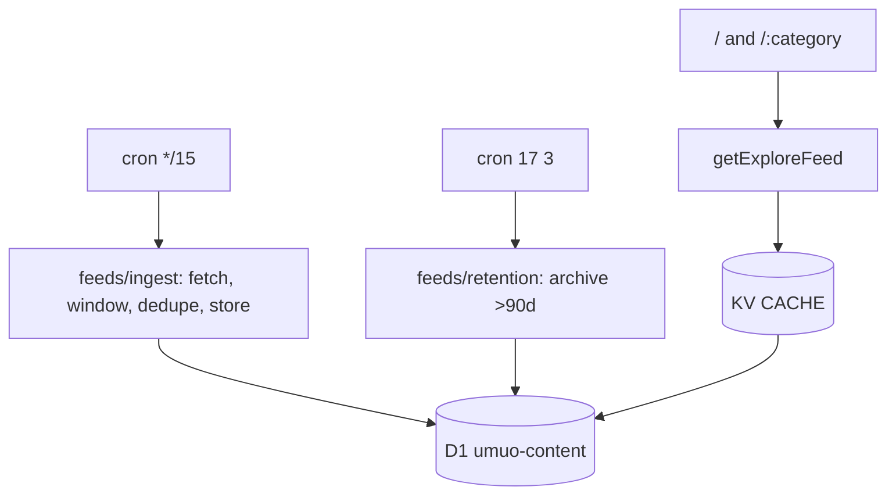

# Repository Guidelines

## Project Overview

This repo is **AI Desk**, a discovery desk for useful tools, thoughtful design, software craft and AI. A Cloudflare cron pulls the Poche Explore RSS (`https://poche.app/explore/rss`, community-curated upstream) every 15 minutes into D1, and an Astro SSR app renders the corpus as a full-bleed masonry board with a category index.

2026 pivots: football → PC hardware → full tech → Poche RSS → an AI-hardware classifier → independent discovery with a model curator → **back to Poche RSS, no model**. Selection is Poche's; the desk only collects. Migration 0020 deletes every non-Poche story, its tags, the other `sources` rows and `agent_runs`: no other source is fetched again, so those rows guarded nothing.

## Architecture & Data Flow

`ingestAllSources` reads every source in `FEED_SOURCES`, applies the freshness window and the per-source cap, normalises to `RawArticle`, drops anything whose fingerprint or canonical URL is already stored, and persists the survivors as they arrived, filed under the category from each item's `· Category` footer.

Reads go through `getExploreFeed` / `getExploreFilters`, cached in KV.

## Key Directories

- `src/pages/` — `/` (explore home) and `/[category]` (per-category hub), thin routes over `BoardPage.astro` that keep their own validation, title, RSS discovery, JSON-LD and the `<script>` that imports `board.ts` (the byte budget traces the board chunk from route entries); `api/[...route].ts` (delegates to `worker/index.ts`), `rss.xml.ts` + `[category]/rss.xml.ts` (RSS 2.0), `sitemap.xml.ts`, `a/[id].ts` (a 301 to the article's source, kept for the per-link URLs the sitemap used to advertise). There are no per-link *pages*: cards link straight to the source.
- `src/feeds/` — the desk's pipeline: `sources.ts` (the Poche registry entry + `INGEST_MAX_AGE_MS`), `ingest.ts` (fetch, window, cap, dedupe, store), `rss.ts` (regex RSS/Atom parse, including Poche's `· Category` footer), `enrich.ts` (row storage: `storeArticle`, `canonicalCategory`), `retention.ts` (sweep + `PRUNE_CRON`) and `types.ts`.
- `src/categories.ts` — the category registry, mirroring Poche's eight labels in two rail groups: curated (Tools, Design, Development) and community (Articles, Social, Media, Web3, Other). Web3 retains the `crypto` storage key and URL; both Crypto and Web3 publisher labels resolve to it.
- `src/data/api.ts` — KV SWR core (`runCached`/`json`) facade + the D1 explore queries and sitemap composer (implementation split across `cache.ts`, `explore.ts`, `sitemapData.ts`). The explore feed's two pure halves sit beside `explore.ts` and are deliberately **not** re-exported by the facade: `exploreArticle.ts` (row → `ExploreArticle` mapping + `EXPLORE_ARTICLE_COLUMNS`) and `exploreCursor.ts` (the keyset codec). `src/data/article.ts` sits outside the facade — it serves the legacy `/a/{id}` redirect and its route imports it directly.
- `src/components/explore/` — `BoardPage.astro` (the board both routes share: the feed and filters fetch, the skip link, `<main>`/`<h1>` and `ExploreView`), `ExploreView` (grouped category rail with its controls at the desktop foot; on mobile the controls are the sticky top bar and the categories are a `
` fan in the bottom-left corner — items stack upward, each turned 2° further, swinging out by a keyframe animation that `board.ts` restarts on every open because Chrome does not restyle a closed `
`; masonry or list; the append sentinel) and `ExploreCard`, which are plain functions returning HTML through `src/components/html.ts` — there is no component framework, on the server or in the browser. The rail, the mobile top bar and the category fan are the only chrome on these pages. Category navigation preserves the view query; the theme toggle (system default until the reader picks one) renders twice and stays in sync. `ExploreGridPage` renders a page as CSS columns (first paint, and the board without JavaScript); on the first append `board.ts` moves the cards into one flex lane per column — each staying in the column it was painted in — and deals every later card to the shortest lane, so pages never leave a gap and earlier cards never move. The client behaviour lives in `src/scripts/board.ts` and the appended pages are rendered by `src/data/exploreCards.ts` for `/cards.json`.
- `migrations/` — D1 schema (0001–0021). Applied by `bun run deploy`, never automatically. A migration the code depends on (a new column it selects) has to be applied *before* the deploy that reads it.
- `worker/entrypoint.ts` — the deployed handler. `fetch` answers `/media/*` itself and hands everything else to Astro; `scheduled` runs ingest or the sweep (told apart by `controller.cron`). `worker/index.ts` is the `/api/*` dispatcher (explore endpoints, then an explicit 404) and is only reachable through `src/pages/api/[...route].ts`.
- `src/media.ts` — rewrites feed-CDN images onto our own origin and serves them at `/media/<storage-id>`. See Gotchas.
- `design-tokens/` — W3C design-tokens JSON; `src/index.css` and `tailwind.config.js` map to it. The accent is the brand violet `#5200ff` in the light theme only: on the dark ground it is ~2.6:1, so dark uses it mixed 1:1 with white (`#a980ff`), and `index.css.test.ts` holds both themes to 4.5:1 where the accent renders. The mark, an impossible triangle of cubes (`public/logo.svg`, `public/favicon.svg`, `public/og.svg`), is generated by `scripts/brand-mark.ts`; edit the script, not the SVGs.

## Development Commands

Bun locally, `workerd` in production.

- `bun run dev` — Astro dev server with local Miniflare KV + D1.
- `bun run build` — `astro check && tsc -p tsconfig.worker.json && astro build` (typecheck gates the build).
- `bun run typecheck` / `lint` / `format` — app + worker types, Biome.
- `bunx vitest run` — full suite. `bunx vitest run <file>`, `-t "<name>"` to narrow. `bun run test` = watch mode.
- `bun run deploy` — **migrations then deploy**. Workers Builds must be configured to run this, not bare `wrangler deploy`, or migrations silently never apply.
- `bun run feeds:probe` — fetch every registered source and run the real parser over the bytes: liveness, items that parse, items the window and cap keep, median text length, images, publisher categories. Run it before changing a source, a cap, or the parser.
- `bunx wrangler d1 execute umuo-content --remote --command "…"` — inspect production data.

## Code Conventions & Common Patterns

- **Biome 2** (on `latest`; `biome.json` reads the installed package's schema, so the two cannot drift): 2-space, single quotes, semicolons, trailing commas, 100 cols, arrow parens always. Excludes `*.css`, `dist`, `.astro`, `**/node_modules`, `**/.wrangler`, `bun.lock`, and `worker-configuration.d.ts` (generated by `wrangler types`; regenerate rather than hand-edit).
- **Naming**: PascalCase components (functions that return `Html`) and layouts, camelCase utilities, tests colocated as `<name>.test.ts`.
- **Server-rendered, no client router, no UI framework.** Every view is an independent document. Navigation is `<a href>`; there is no history API. Markup is built with the `html` tagged template in `src/components/html.ts`, which escapes every interpolation: that is the XSS boundary for feed text React used to be. Only `html` and `attr` can make the `Html` values it passes through as they are (the class is not exported), so feed or request text cannot reach the page as markup. Never assemble markup by concatenating strings, and quote every attribute in a template. Dates are formatted UTC-only, so the server's time zone never reaches the markup.
- **KV SWR core** (`runCached`): fresh window → `HIT`, in-flight coalescing via a module-level `Map`, upstream failure serves stored stale data as `STALE` or 502. It returns a neutral `{ body, status, cache }`, never a `Response`: the HTTP adapters (`serveExplore`, `serveExploreFilters`, `serveExploreRss`) wrap it and emit `x-cache`, and the SSR getters parse the body directly. D1 queries (explore feed, filters, sitemaps) go through it; **every cursor page** bypasses KV (the cursor is user-controlled and unbounded).
- **Degrade, don't crash**: SSR composers return empty arrays on failure; a failed append is reported in place by `board.ts` and the cards already on the page stay. Pages never query D1 directly — they go through `src/data/api.ts` getters.
- **Registries are the source of truth.** `src/categories.ts` (two groups; Poche labels resolve to keys by label), `src/feeds/sources.ts` (the measured source registry and its cap), and `src/site.ts` (canonical origin for canonical/og/sitemap). Adding a category is registry-only.
- **The board's client is one plain module**, `src/scripts/board.ts`, loaded by both board pages: it
  appends a page from `/cards.json` (server-rendered HTML), switches the theme, and wires card media —
  for the server-rendered cards *and* every appended page. Nothing renders in the browser: `ExploreView`
  and `ExploreCard` are server-side functions, and the view toggle is a link rather than state.
- **Copy is English**; Chinese comments explaining non-obvious logic are kept when editing around them.
- **Commits** carry `Co-Authored-By: Claude <noreply@anthropic.com>`.

## Important Files

- `src/categories.ts` — `CATEGORIES: Record<string, Category>` (8 keys in two groups; each carries a `group` the rail renders by). **The single validation gate** for category values — routes, facet filtering, KV-key safety and storage fallback all check against it. `src/feeds/enrich.test.ts` pins that the Poche labels still resolve.
- `src/site.ts` — `SITE_ORIGIN`, `SITE_NAME`, `SITE_TITLE`, `SITE_DESCRIPTION`. The card's deck is the publisher's own teaser (`description`). Cards render feed images directly and hide broken ones; feed-CDN images are re-originated by `src/media.ts`.
- `src/data/api.ts` — `runCached`, `serveExplore`, `serveExploreRss`, `getExploreFeed`/`getExploreFilters`, sitemap composer. `EXPLORE_ARTICLE_COLUMNS` is the single projection; it and the row coercers live in `exploreArticle.ts`, which together with `exploreCursor.ts` holds the parts of the feed that need no D1 stub to test.
- `src/feeds/ingest.ts` — `ingestAllSources(env, ctx)` and `canonicalizeUrl`; `fingerprintFor`, `readSource` (window + cap), `fetchWithRetry` and `RSS_HEADERS` are module-private. Its report carries `trimmed`, which is the only place a publisher switching to an archive feed becomes visible.
- `src/feeds/sources.ts` — `FEED_SOURCES` (Poche Explore alone, `maxItems` 50 = the feed's length) and `INGEST_MAX_AGE_MS`. Ingest reads this registry directly; the `sources` table only exists because `articles.source_id` references it, and `ensureSources` upserts the row.
- `src/feeds/enrich.ts` — row storage and nothing else: `storeArticle` (the ingest-time insert) and `canonicalCategory`.
- `src/feeds/retention.ts` — `PRUNE_CRON = '17 3 * * *'`, `ARTICLE_ARCHIVE_DAYS = 90`.
- `src/media.ts` — `proxiedImageUrl` (rewrites a feed-CDN image onto `SITE_ORIGIN`), `mediaRequest`/`serveMedia` (the `/media/<storage-id>` handler), `isVideoMediaUrl` + `withTemporalFragment` (the video thumbnails), and the id allowlist that keeps it from being an open proxy.
- `worker/entrypoint.ts` / `worker/index.ts` — see Key Directories.
- `wrangler.toml` — all Cloudflare bindings/crons/vars (see Infrastructure).
- `env.d.ts` / `worker/env.d.ts` — hand-declared `Cloudflare.Env` for the two tsconfigs; must match the bindings **and vars** in `wrangler.toml`. The `[vars]` must be restated with the *literal* types `wrangler types` emits — a hand-written `string` conflicts with the generated chain and the error surfaces at `handle(request, env, ctx)` in `worker/entrypoint.ts`, nowhere near the declaration. `src/bindings.test.ts` pins bindings and var literals against `wrangler.toml`; there are no vars or secrets today. `ASSETS` is listed in the worker half only, and it is load-bearing there: drop it and `handle(request, env, ctx)` stops typechecking, because that program excludes the root `env.d.ts` whose `Env` the data layer exports. Nothing in `src/` reads `ASSETS`, so the app half omits it.

## Runtime/Tooling Preferences

- **Dependencies track `latest`.** `package.json` names no versions except one: `typescript` stays `^6` because `@astrojs/check` peers on `^5 || ^6`, and TypeScript 7 is the native port its language server cannot load. `bun.lock` is what pins a build, so Workers Builds stays reproducible; `bun update` is how a version moves, and a new major moves with it — run the full checks and `bun run build` after one. `wrangler` is declared too, so `bun run deploy` runs the version the lockfile names rather than one a plugin happened to bring.
- **Bun is the only supported package manager** (`bun.lock` committed, npm/yarn/pnpm locks gitignored). Run tests via `bunx vitest`, never `bun test` (Bun's built-in runner ignores `vitest.config.ts`).
- **Config file is `wrangler.toml`** — not `wrangler.jsonc`.
- `worker-configuration.d.ts` is generated by `wrangler types` — regenerate after changing bindings/vars, never hand-edit. Biome excludes it.
- **No Durable Objects, deliberately.** Workers Builds runs `wrangler versions upload` for PR previews, which cannot apply a DO migration — adding one breaks every PR build.
- **No CI in the repo.** Deployment is Cloudflare Workers Builds from `main`, which must run `bun run deploy` (migrations-then-deploy) or migrations never apply.

## Infrastructure

|||
|---|---|
|Worker|`ai`, deployed by Workers Builds from `main`, served at `ai.um1ng.me`|
|KV|`CACHE` `b5d6927ae…`|
|D1|`DB` → `umuo-content`, primary region **APAC** (cannot be moved without recreating). The name predates the desk's rename: D1 databases cannot be renamed, so it stays|
|Crons|`*/15 * * * *` ingest, `17 3 * * *` retention sweep|

## Testing & QA

Vitest 5, `jsdom`, `globals: true`, `fileParallelism: false` (tests mutate global fetch and location). `src/test-setup.ts` runs `afterEach(vi.restoreAllMocks())`; assertions are plain Vitest matchers. Files needing node/workerd semantics carry `// @vitest-environment node` as the first directive, including `worker/index.test.ts` (where the workers-types reference precedes it).

Patterns:
- `ssr.test.ts` renders the board in the node environment (no `document`, like workerd) and pins the escaping contract on the page; `exploreCards.test.ts` pins it on the `/cards.json` fragment. `board.test.ts` mounts the same markup with `innerHTML` and drives `board.ts` against it.
- Fetch mocking via `vi.stubGlobal('fetch', fetchMock)` (must `vi.unstubAllGlobals()` yourself) or module-scope `globalThis.fetch = …` (`worker/index.test.ts`).
- Routes/worker tested by calling `worker.fetch(new Request('https://x/api/explore'), env, mockCtx())` directly — there is no Astro middleware/`onRequest`.
- KV/D1 mocked as `vi.fn()` spy objects cast `as unknown as Env` / `as unknown as Env['DB']`; SQL-capture mocks assert on `capturedSql`/`capturedBindings`.
- Module mocking via `vi.hoisted` + `vi.mock` before importing the module under test when a test needs to replace an import.
- **Binding tests** pin duplicated constants to their on-disk copy: `retention.cron.test.ts` (wrangler.toml `crons` ↔ `PRUNE_CRON`), `bindings.test.ts` (wrangler.toml bindings/vars/secrets ↔ both `env.d.ts` files), `index.css.test.ts` (design-tokens ↔ `index.css`). File-reading tests use `resolve(process.cwd(), …)` — jsdom mangles `import.meta.url`.
- **End-to-end**: build, then drive the schedule directly —
  `bunx wrangler dev --config dist/server/wrangler.json --port 8787 --local --test-scheduled`
  `curl "http://127.0.0.1:8787/cdn-cgi/handler/scheduled?cron=*/15+*+*+*+*"`
  Then query the local D1 for `articles`. A rebuild regenerates `dist/server/wrangler.json` and therefore lands on a **fresh, empty** local D1 — re-apply migrations first (`scripts/README.md`).

**A passing suite is not evidence code runs.** Modules have kept green suites long after nothing imported them. When you delete a module, delete its tests, then walk imports from every route and `worker/entrypoint.ts` to see what else is orphaned. (Done for the football removal: `newsFeed.ts`, its JSON contract, the `obj/arr/str/slugify` ESPN coercers and the BBC image rewriter all went together.)

## Gotchas

Each of these cost real debugging. They are not hypothetical.

- **A feed can ship its entire archive.** Measured when the desk was built: `openai.com/news` returned **1247** items and `huggingface.co/blog` 874, of which 11 and 6 were inside a week. Two guards, in this order: `INGEST_MAX_AGE_MS` (7 days) and then the source's `maxItems` cap, both in `readSource`. Capping before the window would just slice the archive. The first real tick parsed 1672 items and kept 179 — if that ratio ever inverts, the caps are gone. `report.trimmed` is where this shows up.
- **A source is a measurement, not a guess.** Every entry in `FEED_SOURCES` was probed with the real parser first (that is what `bun run feeds:probe` is for, and it reads the live registry). Candidates rejected earlier for measured reasons: 403 to our user agent (`videocardz`, `hpcwire`), a 15s timeout (`blog.google/…/ai/rss`), RSS 1.0/RDF that this regex parser reads as zero items (`export.arxiv.org/rss/cs.AR`), and feeds whose items carry **no text at all** (`huggingface.co/blog`, `nextplatform.com`).
- **The registry must mirror Poche's category labels.** `storeArticle` stores `canonicalCategory(publisher)`; a Poche label the registry does not carry stores `NULL`, so the story reaches the global board but no hub. `unmappedCategories` in the scheduled log names the missing label. Probed 2026-10-20: 50/50 items categorised.
- **The curator's columns are still in the schema, unread.** `ai_summary`/`ai_blurb` (NOT NULL, so `storeArticle` writes `''`), `quality_score`, `is_on_topic`, `article_type`, `freshness_score`, `enriched_at`, `title_norm` and the generated `day_bucket` stay because dropping columns is a schema change for no reader-visible gain; nothing selects them since 0021, and every other one takes its default.
- **`[vars]` are typed as literals, and that is a landmine.** `wrangler types` emits a var as its literal value, so the hand-written declarations in `env.d.ts`/`worker/env.d.ts` must repeat the literal — a `string` there conflicts with the generated chain and the failure appears at `handle(request, env, ctx)` with no mention of the var. `bindings.test.ts` pins the three files together. A local `.dev.vars` also leaks into `wrangler types` output, so regenerate without one.
- **Explore cursors are keyset, not offsets** — `<published_at>:<id>`, both immutable, so the keyset is stable under inserts; `idx_feed_global`/`idx_feed_category` (0021) are the seek targets. Ids are SHA-256 hex, so a cursor whose id holds a colon is a pre-0021 four-part cursor and collapses to page one. Type guards on `ExploreFeed.nextCursor` must say `string`; when one said `number`, every SSR page silently reported the feed exhausted.
- **`PRUNE_CRON` is duplicated in `wrangler.toml`** because a Worker cannot read that file. `retention.cron.test.ts` holds them together. Anything that is not `PRUNE_CRON` is treated as an ingest tick, so a stray third schedule means an extra full fan-out.
- **Never DELETE Poche rows from `articles`.** Retention archives instead: dropping a row takes its `canonical_url` and `fingerprint` with it, and the next tick would re-ingest the same story. Migrations 0009 (football) and 0010 (pre-Poche tech) soft-offline retired corpora while preserving those dedupe guards. Migration 0011 only cleared stale `title_norm` values — it retired no corpus.
- **`article_tags` is empty and unread.** Only the retired curator wrote it; the explore projection stopped joining it in 0021. Never mirror the category into it — that was the 0012 defect (cards rendered "Development · development").
- **Dedupe before storage.** `ingestAllSources` filters stored fingerprints and canonical URLs before `storeArticle`. Both matter: a rewritten headline on a stored URL looks like a new fingerprint.
- **Explore cache keys embed the query.** Deep pages bypass KV entirely: a cursor is user-controlled and unbounded, so caching it let anyone write KV keys without limit. It is re-serialised from its parsed form only so a malformed one collapses to page one — the request bypasses KV anyway, and the id it carries is verbatim, so the key space would be unbounded. Free-text `q` was removed with the header's search box; `exploreQueryFromUrl` no longer reads it.
- **`description` is fingerprint-stable.** The feed teaser is stored capped at 4000 characters, while only its first 240 characters (plus the URL host and path) feed the fingerprint; keep that behavior stable unless you intend to re-ingest the corpus.
- **Cron runs are deployment-driven, but a tick can be driven locally.** `wrangler dev` does not fire the production schedule; run it with `--test-scheduled` and drive the handler directly: `curl "http://127.0.0.1:8787/cdn-cgi/handler/scheduled?cron=*/15+*+*+*+*"` (`/__scheduled` is the older path and 404s on wrangler 4.147). In production, trigger by hand with a one-shot cron, deploy, let it fire, then remove it. Note the local D1 is named from `dist/server/wrangler.json`, so **a rebuild lands on an empty database** — see `scripts/README.md`.
- **`/media/<id>` is not an open proxy.** It re-serves feed-CDN images so that origin never appears in card markup or `og:image`. The route takes a storage id and never a URL: `src/media.ts` checks a UUID pattern before building the upstream URL, so the `/api/img?src=<any-url>` proxy the football desk removed is *not* what this is — `worker/index.test.ts` keeps a guard that URL-shaped input still 404s. An unrecognised path on the upstream origin is dropped rather than forwarded, since forwarding it would leak the host the module exists to hide. Do not add a `?src=` form: that is the SSRF hole. Reads are edge-cached for a day (`cacheEverything`), the stored `articles.image_url` keeps the upstream value, and the rewrite happens at read time in `exploreArticle`. **The route lives in `worker/entrypoint.ts`, not `worker/index.ts`** — Astro mounts that dispatcher at `/api/*` only, so a `/media/` handler placed there is unreachable and every proxied image 404s against `ASSETS`; `worker/entrypoint.test.ts` guards that wiring by asserting a storage-id request is answered without consulting Astro. **It must also claim only storage ids and hand everything else back.** `/media/` is the path of the `media` category hub as well as the proxy prefix, so claiming the whole prefix swallowed `/media/rss.xml` — that hub's own feed — and answered 404 for a URL `/sitemap.xml` advertises. `mediaRequest` returns null for any non-id, and that same test file asserts such a path does reach Astro's handler.
