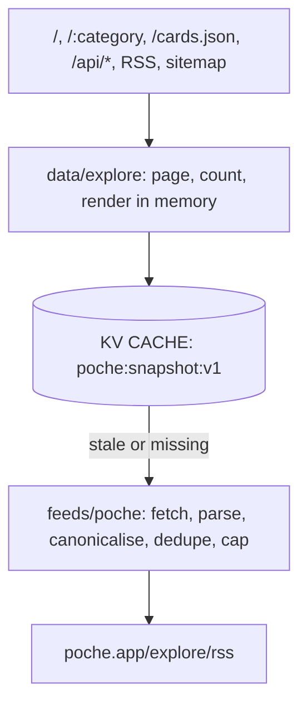

# Repository Guidelines

## Project Overview

This repo is **AI Desk**, a discovery desk for useful tools, thoughtful design, software craft and AI. An Astro SSR app on a Cloudflare Worker renders the Poche Explore RSS (`https://poche.app/explore/rss`, community-curated upstream) as a full-bleed masonry board with a category index.

2026 pivots: football → PC hardware → full tech → Poche RSS → an AI-hardware classifier → independent discovery with a model curator → back to Poche RSS, no model → **no database**. Selection is Poche's; the desk only shows it. The board is Poche's current feed (~50 links), fetched on demand and held as one KV snapshot. There is no D1, no cron, no migrations and no archive: a link that leaves Poche's feed leaves the board.

## Architecture & Data Flow

Every surface reads **one** KV entry, `poche:snapshot:v1`: the parsed feed as `ExploreArticle[]`, newest first. `runCached` keeps it fresh for 10 minutes and serves it stale for up to 7 days; when it is stale the request that notices re-fetches Poche (one attempt, 8s timeout) and a failure serves the stale copy. Category filtering, the keyset cursor, rail counts, RSS and sitemap hubs are pure functions over that array (`explorePage`, `exploreFilters` in `src/data/explore.ts`).

## Key Directories

- `src/pages/` — `/` (explore home) and `/[category]` (per-category hub), thin routes over `BoardPage.astro` that keep their own validation, title, RSS discovery, JSON-LD and the `<script>` that imports `board.ts` (the byte budget traces the board chunk from route entries); `api/[...route].ts` (delegates to `worker/index.ts`), `rss.xml.ts` + `[category]/rss.xml.ts` (RSS 2.0), `sitemap.xml.ts`, `cards.json.ts`. There are no per-link pages: cards link straight to the source, and the old `/a/{id}` redirect went with the database (it 404s).
- `src/feeds/` — the upstream: `sources.ts` (`POCHE_FEED`: URL + `maxItems` cap), `rss.ts` (regex RSS/Atom parse, including Poche's `· Category` footer), `poche.ts` (`fetchPocheFeed`: fetch with `RSS_HEADERS`, `canonicalizeUrl`, one entry per URL, sort, cap, map to `ExploreArticle` with `id` = SHA-256 of the canonical URL) and `types.ts`.
- `src/categories.ts` — the category registry, mirroring Poche's eight labels in two rail groups: curated (Tools, Design, Development) and community (Articles, Social, Media, Web3, Other), plus `canonicalCategory` (publisher label → key). Web3 retains the `crypto` key and URL; both Crypto and Web3 publisher labels resolve to it.
- `src/data/api.ts` — facade over `cache.ts` (KV SWR core `runCached`/`json`), `explore.ts` (the snapshot read and every surface over it, including the sitemap hubs) and `health.ts`. `exploreCursor.ts` (the keyset codec) and `exploreRss.ts` (the renderer) are pure and not re-exported.
- `src/components/explore/` — `BoardPage.astro` (the board both routes share: the feed and filters fetch, the skip link, `<main>`/`<h1>` and `ExploreView`), `ExploreView` (grouped category rail with its controls at the desktop foot; on mobile the controls are the sticky top bar and the categories are a `
` bottom sheet behind a button at the bottom centre — the same rail markup, two rows to a line at 44px (that `min-height` is unlayered CSS, because the rail's `min-h-7` utility outranks the components layer), the button becoming Close while open; it eases in on a native-sheet curve, and `board.ts` plays the way out (`[data-closing]`) before closing the `
`, drags it down from the grab handle, and restarts the opening animation on every open because Chrome does not restyle a closed `
`; masonry or list; the append sentinel) and `ExploreCard`, which are plain functions returning HTML through `src/components/html.ts` — there is no component framework, on the server or in the browser. The rail, the mobile top bar and the category sheet are the only chrome on these pages. Category navigation preserves the view query; the theme toggle (system default until the reader picks one) renders twice and stays in sync. `ExploreGridPage` renders a page as CSS columns (first paint, and the board without JavaScript); on the first append `board.ts` moves the cards into one flex lane per column — each staying in the column it was painted in — and deals every later card to the shortest lane, so pages never leave a gap and earlier cards never move. The client behaviour lives in `src/scripts/board.ts` and the appended pages are rendered by `src/data/exploreCards.ts` for `/cards.json`.
- `worker/entrypoint.ts` — the deployed handler: `fetch` answers `/media/*` itself and hands everything else to Astro. There is no `scheduled` export and no `crons/` directory. `worker/index.ts` is the `/api/*` dispatcher (health, explore, filters, then an explicit 404) and is only reachable through `src/pages/api/[...route].ts`.
- `src/media.ts` — rewrites feed-CDN images onto our own origin and serves them at `/media/<storage-id>`. See Gotchas.
- `design-tokens/` — W3C design-tokens JSON; `src/index.css` and `tailwind.config.js` map to it. The accent is the brand violet `#5200ff` in the light theme only: on the dark ground it is ~2.6:1, so dark uses it mixed 1:1 with white (`#a980ff`), and `index.css.test.ts` holds both themes to 4.5:1 where the accent renders. The mark, an impossible triangle of cubes (`public/logo.svg`, `public/favicon.svg`, `public/og.svg`), is generated by `scripts/brand-mark.ts`; edit the script, not the SVGs.

## Development Commands

Bun locally, `workerd` in production.

- `bun run dev` — Astro dev server with local Miniflare KV; the first request fetches the live Poche feed.
- `bun run build` — `astro check && tsc -p tsconfig.worker.json && astro build` (typecheck gates the build).
- `bun run typecheck` / `lint` / `format` — app + worker types, Biome.
- `bunx vitest run` — full suite. `bunx vitest run <file>`, `-t "<name>"` to narrow. `bun run test` = watch mode.
- `bun run deploy` — `scripts/deploy.sh`, i.e. `bunx --bun void deploy --platform cloudflare`: builds, uploads, verifies the new version, then moves traffic. Cloudflare Workers Builds runs it on every push to `main` (build command `bun run build` for the typecheck and byte budgets, which `void deploy` skips; deploy command `bun run deploy`); locally it signs you in on first use. The Void CLI needs Node ≥ 24.21 and the build image has 24.18, so the script runs Void on Bun (`bunx --bun`).
- `bun run feeds:probe` — fetch Poche with the Worker's headers and run the real parser and normaliser: liveness, items parsed and kept, median text length, images, categorised items, unmapped publisher categories. Run it before changing the source, the cap, or the parser.

## Code Conventions & Common Patterns

- **Biome 2** (on `latest`; `biome.json` reads the installed package's schema, so the two cannot drift): 2-space, single quotes, semicolons, trailing commas, 100 cols, arrow parens always. Excludes `*.css`, `dist`, `.astro`, `**/node_modules`, `**/.wrangler`, `bun.lock`, and `worker-configuration.d.ts` (generated by `wrangler types`; regenerate rather than hand-edit).
- **Naming**: PascalCase components (functions that return `Html`) and layouts, camelCase utilities, tests colocated as `<name>.test.ts`.
- **Server-rendered, no client router, no UI framework.** Every view is an independent document. Navigation is `<a href>`; there is no history API. Markup is built with the `html` tagged template in `src/components/html.ts`, which escapes every interpolation: that is the XSS boundary for feed text React used to be. Only `html` and `attr` can make the `Html` values it passes through as they are (the class is not exported), so feed or request text cannot reach the page as markup. Never assemble markup by concatenating strings, and quote every attribute in a template. Dates are formatted UTC-only, so the server's time zone never reaches the markup.
- **KV SWR core** (`runCached`): fresh window → `HIT`, in-flight coalescing via a module-level `Map`, upstream failure serves stored stale data as `STALE` or 502. It returns a neutral `{ body, status, cache }`, never a `Response`. It is used for exactly one key, the snapshot; the HTTP adapters (`serveExplore`, `serveExploreFilters`, `serveExploreRss`) emit its state as `x-cache`.
- **Request input never reaches a KV key.** Category, cursor and limit are applied in memory *after* the snapshot read, so no request can mint a key.
- **Degrade, don't crash**: an unreadable snapshot (cold cache + Poche down) makes `getExploreFeed` return `unavailable: true`, the rail fall back to the registry with `count: null`, the sitemap answer 503 and the JSON/RSS endpoints 502; a failed append is reported in place by `board.ts` and the cards already on the page stay. Pages go through `src/data/api.ts` getters.
- **Registries are the source of truth.** `src/categories.ts` (two groups; Poche labels resolve to keys by label), `src/feeds/sources.ts` (the upstream and its cap), and `src/site.ts` (canonical origin for canonical/og/sitemap). Adding a category is registry-only.
- **The board's client is one plain module**, `src/scripts/board.ts`, loaded by both board pages: it
  appends a page from `/cards.json` (server-rendered HTML), switches the theme, and wires card media —
  for the server-rendered cards *and* every appended page. Nothing renders in the browser: `ExploreView`
  and `ExploreCard` are server-side functions, and the view toggle is a link rather than state.
- **Copy is English**; Chinese comments explaining non-obvious logic are kept when editing around them.
- **Commits** carry `Co-Authored-By: Claude <noreply@anthropic.com>`.

## Important Files

- `src/categories.ts` — `CATEGORIES: Record<string, Category>` (8 keys in two groups; each carries a `group` the rail renders by) and `canonicalCategory`. **The single validation gate** for category values — routes and filtering check against it with `Object.hasOwn`. `src/categories.test.ts` pins that the Poche labels still resolve.
- `src/site.ts` — `SITE_ORIGIN`, `SITE_NAME`, `SITE_TITLE`, `SITE_DESCRIPTION`. The card's deck is the publisher's own teaser (`description`). Cards render feed images directly and hide broken ones; feed-CDN images are re-originated by `src/media.ts`.
- `src/data/explore.ts` — `SNAPSHOT_KEY` and its fresh/keep windows, `explorePage` (filter + keyset page), `exploreFilters` (rail counts), `serveExplore`/`serveExploreFilters`/`serveExploreRss`, `getExploreFeed`/`getExploreFilters`/`getSitemapNews`, `snapshotReadable` (health). Bump `SNAPSHOT_KEY`'s version whenever `ExploreArticle` changes shape: a warm entry is parsed straight into it.
- `src/feeds/poche.ts` — `fetchPocheFeed` (throws on non-2xx **and on an empty parse**, so a broken feed never overwrites a good snapshot), `toExploreArticles`, `canonicalizeUrl`, `RSS_HEADERS` (shared with the scripts).
- `src/feeds/sources.ts` — `POCHE_FEED` (`maxItems` 50 = the feed's length; the cap bounds the KV entry if Poche ever ships an archive).
- `src/media.ts` — `proxiedImageUrl` (rewrites a feed-CDN image onto `SITE_ORIGIN`), `mediaRequest`/`serveMedia` (the `/media/<storage-id>` handler), `isVideoMediaUrl` + `withTemporalFragment` (the video thumbnails), and the id allowlist that keeps it from being an open proxy.
- `worker/entrypoint.ts` / `worker/index.ts` — see Key Directories.
- `void.config.ts` — all Cloudflare bindings, vars and the custom `main` (see Infrastructure). Void generates `.void-wrangler.jsonc` from it (gitignored, never edited) for the Astro adapter and deploys; `void.lock.json`, once Void writes it, is committed.
- `env.d.ts` / `worker/env.d.ts` — hand-declared `Cloudflare.Env` for the two tsconfigs (`CACHE`, plus `ASSETS` in the worker half); must match the bindings **and vars** in `void.config.ts`. The `[vars]` must be restated with the *literal* types `wrangler types` emits — a hand-written `string` conflicts with the generated chain and the error surfaces at `handle(request, env, ctx)` in `worker/entrypoint.ts`, nowhere near the declaration. `src/bindings.test.ts` pins bindings and var literals against `void.config.ts` (it imports the config object); there are no vars or secrets today. `ASSETS` is listed in the worker half only, and it is load-bearing there: drop it and `handle(request, env, ctx)` stops typechecking, because that program excludes the root `env.d.ts` whose `Env` the data layer exports. Nothing in `src/` reads `ASSETS`, so the app half omits it.

## Runtime/Tooling Preferences

- **Dependencies track `latest`.** `package.json` names no versions except one: `typescript` stays `^6` because `@astrojs/check` peers on `^5 || ^6`, and TypeScript 7 is the native port its language server cannot load. `bun.lock` is what pins a build, so CI stays reproducible; `bun update` is how a version moves, and a new major moves with it — run the full checks and `bun run build` after one. `void` (the deployer) and `wrangler` (local dev, `d1 execute`, `types`) are declared too, so both run the versions the lockfile names; Void's docs ask that its CLI and adapters move together, which one lockfile does.
- **Bun is the only supported package manager** (`bun.lock` committed, npm/yarn/pnpm locks gitignored). Run tests via `bunx vitest`, never `bun test` (Bun's built-in runner ignores `vitest.config.ts`).
- **Config file is `void.config.ts`** — there is no `wrangler.toml`. Astro's adapter reads the generated `.void-wrangler.jsonc` (`configPath` in `astro.config.mjs`; `astro build` regenerates it, `void prepare` alone does not), and `cloudflare.main` keeps `worker/entrypoint.ts` as the Worker entry: Void preserves it for Astro (verified: the built Worker keeps `/media`).
- `worker-configuration.d.ts` is generated by `wrangler types --config .void-wrangler.jsonc` — regenerate after changing bindings/vars, never hand-edit. Biome excludes it.
- **No Durable Objects, deliberately.** Void stages each upload and verifies it before moving traffic; a Durable Object that Cloudflare cannot stage forces atomic deploys, and its class migrations cannot be rolled back.
- **No CI in the repo.** Cloudflare Workers Builds deploys `main` by running `bun run deploy` (Void), so no GitHub secrets are needed; Void reads the build token from `CLOUDFLARE_API_TOKEN`, and `scripts/deploy.sh` fails plainly if a build lacks it. Non-production branch builds are off, and so are `workers_dev` and `preview_urls`: the Worker answers only at `ai.um1ng.me`.

## Infrastructure

|||
|---|---|
|Worker|`ai`, deployed by Workers Builds running `void deploy` on push to `main`, served at `ai.um1ng.me`|
|KV|`CACHE` `b5d6927ae…`|
|KV key|`poche:snapshot:v1` — fresh 10 min, kept 7 days|
|Upstream|`https://poche.app/explore/rss`, fetched by the Worker on a stale read|

The D1 database `umuo-content` the desk used to read is no longer bound, but it still exists (the old `umuo` Worker may bind it). Deleting it is a separate, irreversible decision for the owner, not part of a deploy.

## Testing & QA

Vitest 5, `jsdom`, `globals: true`, `fileParallelism: false` (tests mutate global fetch and location). `src/test-setup.ts` runs `afterEach(vi.restoreAllMocks())`; assertions are plain Vitest matchers. Files needing node/workerd semantics carry `// @vitest-environment node` as the first directive, including `worker/index.test.ts` (where the workers-types reference precedes it).

Patterns:
- `src/data/explore.test.ts` drives every surface through a stubbed KV and `fetch`; `src/feeds/poche.test.ts` covers canonicalisation, dedupe, the id and the fetch contract.
- `ssr.test.ts` renders the board in the node environment (no `document`, like workerd) and pins the escaping contract on the page; `exploreCards.test.ts` pins it on the `/cards.json` fragment. `board.test.ts` mounts the same markup with `innerHTML` and drives `board.ts` against it.
- Fetch mocking via `vi.stubGlobal('fetch', fetchMock)` (must `vi.unstubAllGlobals()` yourself) or module-scope `globalThis.fetch = …` (`worker/index.test.ts`).
- Routes/worker tested by calling `worker.fetch(new Request('https://x/api/explore'), env, mockCtx())` directly — there is no Astro middleware/`onRequest`.
- KV mocked as `vi.fn()` spy objects cast `as unknown as Env`; a stored snapshot is `{ body: JSON.stringify(articles), at }`. The upstream is mocked through `fetch` with an RSS string.
- Module mocking via `vi.hoisted` + `vi.mock` before importing the module under test when a test needs to replace an import.
- **Binding tests** pin duplicated constants to their on-disk copy: `bindings.test.ts` (`void.config.ts` bindings/vars/secrets ↔ both `env.d.ts` files), `index.css.test.ts` (design-tokens ↔ `index.css`). File-reading tests use `resolve(process.cwd(), …)` — jsdom mangles `import.meta.url`.
- **End-to-end**: `bun run build`, then `bunx wrangler dev --config dist/server/wrangler.json --port 8787 --local` and `curl` `/api/health`, `/api/explore?limit=3`, `/cards.json?cursor=…`, `/tools/rss.xml`, `/sitemap.xml`. The first request fetches the live feed.

**A passing suite is not evidence code runs.** Modules have kept green suites long after nothing imported them. When you delete a module, delete its tests, then walk imports from every route and `worker/entrypoint.ts` to see what else is orphaned. (Done for the football removal, and for the D1 removal: ingest, retention, the cron, migrations, the `/a/{id}` redirect, the row mapper and the `num`/`sleep` helpers all went together.)

## Gotchas

Each of these cost real debugging. They are not hypothetical.

- **A feed can ship its entire archive.** Measured when the desk was built: `openai.com/news` returned **1247** items and `huggingface.co/blog` 874. The whole parsed feed becomes one KV entry, so `toExploreArticles` keeps the newest `POCHE_FEED.maxItems` (50, Poche's length). If `feeds:probe` ever shows `parsed` far above `kept`, Poche changed what it ships.
- **A source is a measurement, not a guess.** Probe with the real parser first (`bun run feeds:probe`). Candidates rejected earlier for measured reasons: 403 to our user agent (`videocardz`, `hpcwire`), a 15s timeout (`blog.google/…/ai/rss`), RSS 1.0/RDF that this regex parser reads as zero items (`export.arxiv.org/rss/cs.AR`), and feeds whose items carry **no text at all** (`huggingface.co/blog`, `nextplatform.com`).
- **The registry must mirror Poche's category labels.** A Poche label `canonicalCategory` cannot resolve becomes `category: null`: the link reaches the global board but no hub. `feeds:probe` prints any unmapped label. Probed 2026-10-30: 50/50 items categorised.
- **An empty parse must never be cached.** `fetchPocheFeed` throws when the feed parses to nothing (Poche restyling its markup, an HTML error page served with 200), so `runCached` keeps serving the stale snapshot instead of replacing the board with nothing. With no archive behind it, that stale copy (kept 7 days) is the only thing between a Poche outage and an empty board.
- **The upstream fetch runs on a reader's request.** `runCached` revalidates inline: the first request after the 10-minute fresh window waits for Poche. That is why the fetch is one attempt with an 8s timeout and no retry loop; a failure serves the stale snapshot and the next request tries again. Coalescing via the in-flight `Map` is per isolate only.
- **The snapshot key is versioned.** A warm `poche:snapshot:v1` entry is parsed straight into `ExploreArticle[]` with no mapper, so a shape change keeps being served in the old shape for up to the 7-day keep window unless the version is bumped.
- **Explore cursors are keyset, not offsets** — `<publishedAt>:<id>`, both stable per link, so a page fetched after the snapshot refreshed still resumes in the right place. The snapshot is sorted by the same order (`publishedAt` desc, then `id` desc), and `explorePage` must compare in it. `id` is SHA-256 of the canonical URL (it used to be a D1 content fingerprint, so cursors from before the D1 removal resolve to nothing past their timestamp, harmlessly). Type guards on `ExploreFeed.nextCursor` must say `string`; when one said `number`, every SSR page silently reported the feed exhausted.
- **No crons.** Void installs schedules only from job files in `crons/`, and there are none, so every deploy publishes an empty schedule. Do not add `triggers` to `void.config.ts`: Void ignores them.
- **`[vars]` are typed as literals, and that is a landmine.** `wrangler types` emits a var as its literal value, so the hand-written declarations in `env.d.ts`/`worker/env.d.ts` must repeat the literal — a `string` there conflicts with the generated chain and the failure appears at `handle(request, env, ctx)` with no mention of the var. `bindings.test.ts` pins the three files together. A local `.dev.vars` also leaks into `wrangler types` output, so regenerate without one.
- **Change Worker `ai` only through a deploy.** Void's upload path depends on the Worker: with secrets it uploads through the API, without them through `cf workers versions create`, which in CI is strict and aborts ("last updated via the script API") when the script's `last_deployed_from` is `api`. Deleting the last secret with `wrangler secret delete` did exactly that on 2026-10-22. To unblock without moving traffic: `bun run build && bunx wrangler versions upload --config dist/server/wrangler.json`, then retry the build.
- **`/media/<id>` is not an open proxy.** It re-serves feed-CDN images so that origin never appears in card markup or `og:image`. The route takes a storage id and never a URL: `src/media.ts` checks a UUID pattern before building the upstream URL, so the `/api/img?src=<any-url>` proxy the football desk removed is *not* what this is — `worker/index.test.ts` keeps a guard that URL-shaped input still 404s. An unrecognised path on the upstream origin is dropped rather than forwarded, since forwarding it would leak the host the module exists to hide. Do not add a `?src=` form: that is the SSRF hole. Reads are edge-cached for a day (`cacheEverything`), the stored `articles.image_url` keeps the upstream value, and the rewrite happens at read time in `exploreArticle`. **The route lives in `worker/entrypoint.ts`, not `worker/index.ts`** — Astro mounts that dispatcher at `/api/*` only, so a `/media/` handler placed there is unreachable and every proxied image 404s against `ASSETS`; `worker/entrypoint.test.ts` guards that wiring by asserting a storage-id request is answered without consulting Astro. **It must also claim only storage ids and hand everything else back.** `/media/` is the path of the `media` category hub as well as the proxy prefix, so claiming the whole prefix swallowed `/media/rss.xml` — that hub's own feed — and answered 404 for a URL `/sitemap.xml` advertises. `mediaRequest` returns null for any non-id, and that same test file asserts such a path does reach Astro's handler.
