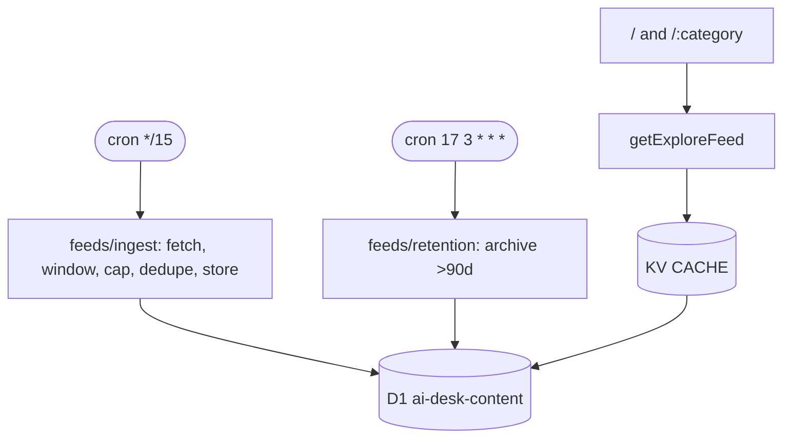

# AI Desk

> A discovery desk for useful tools, thoughtful design, software craft and AI. A Cloudflare cron pulls [Poche Explore](https://poche.app/explore)'s RSS into D1, and Astro renders a fast masonry board with category hubs and RSS feeds.

[](https://bun.sh) [](https://astro.build) [](./LICENSE)

*No ads, no tracking, no reader-side JS framework. The source registry in `src/feeds/sources.ts` and the taxonomy in `src/categories.ts` are yours to replace.*

---

## Editorial direction

Selection is upstream: the desk mirrors [Poche Explore](https://poche.app/explore/rss),
a community-curated feed of tools, design, development and AI links. Each item's
`· Category` footer files it under a hub. There is no model in the pipeline.

Stories from earlier, independently collected sources were deleted (migration 0020).

## Features

- **15-min cron ingest** — fetches every registered feed, applies a 7-day freshness window and a per-source cap (one publisher ships 1247 items), de-duplicates by fingerprint + canonical URL, and stores the survivors straight into D1
- **KV SWR cache** — `runCached` with stale-while-revalidate, request coalescing, bounded keys (cursor pages bypass KV)
- **Masonry board** — native CSS multi-column, infinite scroll, per-category `/[category]` hubs
- **SEO ready** — `/rss.xml`, `/[category]/rss.xml`, `/sitemap.xml`, canonical/og tags, JSON-LD
- **Ops** — `/api/health` reports the deployed version, probes D1 and the cache binding (answering `503` when either is unreachable)
- **Probed** — `bun run feeds:probe` checks every source against the real parser before you trust it

## Tech stack

Astro 7, server-rendered with no UI framework · Cloudflare Workers (workerd) · D1 + KV · Tailwind · Vitest · Biome · Bun

## Prerequisites

- **Bun ≥ 1.4.2** (`packageManager: bun@1.4.2`)
- Cloudflare account; [Void](https://void.cloud) deploys (`bunx --bun void deploy` signs you in on first use). Void's CLI needs Node ≥ 24.21 — or run it on Bun with `--bun`

## Quick start

```bash
git clone https://github.com/youming-ai/ai my-desk && cd my-desk
bun install

# One-time Cloudflare setup. void.config.ts holds this deployment's own
# config: change `name`, then create your own KV namespace and D1 database
# and put their IDs in it.
bunx wrangler kv namespace create CACHE
bunx wrangler d1 create ai-desk-content

bun run dev        # http://localhost:4321 (Miniflare KV + D1)
bun run feeds:probe  # check the registered sources against the real parser
```

| Command | What it does |
|---------|--------------|
| `bun run dev` | Astro dev with local Miniflare |
| `bunx vitest run` | All tests (watch: `bun run test`) |
| `bun run typecheck` | `astro check` + `tsc -p tsconfig.worker.json` |
| `bun run lint` / `format` | Biome |
| `bun run deploy` | `void deploy`: build, apply pending D1 migrations (after a Time Travel restore point), upload, verify, switch traffic |

## Configuration

All knobs are code, not env spaghetti. Edit one file per concern:

| Concern | File | Notes |
|---------|------|-------|
| Branding / origin | `src/site.ts` | `SITE_ORIGIN`, `SITE_NAME`, `SITE_TITLE`, `SITE_DESCRIPTION` |
| Icons / social card | `scripts/brand-mark.ts` → `public/logo.svg`, `public/favicon.svg`, `public/og.svg` | The SVGs are generated (the impossible-triangle mark is computed, not drawn): change the script, run `bun scripts/brand-mark.ts`, then rasterize `og.svg` to `og.png` (the default `og:image`) with `sips` on macOS, or any SVG rasterizer elsewhere (e.g. `rsvg-convert -w 1200 public/og.svg -o public/og.png`) |
| Taxonomy | `src/categories.ts` | `CATEGORIES` — keys become `/:category` routes. Poche labels resolve to keys by label; Web3 retains the historical `crypto` key |
| Sources | `src/feeds/sources.ts` | Poche Explore, with a per-tick `maxItems` cap; `INGEST_MAX_AGE_MS` is the freshness window |
| Retention | `src/feeds/retention.ts` | `ARTICLE_ARCHIVE_DAYS` (default 90) |
| Analytics | `src/layouts/Layout.astro` | `TODO(template)` hook — add yours there, nothing ships by default |

No secrets.

## Architecture



- **Ingest** — fetches every source, keeps what is inside the window and under the cap, de-duplicates, stores.
- **Reads** — `getExploreFeed` via `runCached`; cursor pages bypass KV (unbounded key space).
- **Retention** — archive, never `DELETE` (keeps `fingerprint`/`canonical_url` guards).

## Product surface

| Route | Description |
|-------|-------------|
| `/` | Global board + rail |
| `/:category` | Per-category hub (e.g. `/design`) |
| `/rss.xml`, `/:category/rss.xml` | RSS 2.0 |
| `/sitemap.xml` | Sitemap — category hubs and feeds |
| `/media/<uuid>` | Feed-CDN images, re-served under this origin. Unrecognised but validly encoded `/media/…` paths fall through to the app; malformed percent-encoding is answered `400` |
| `/a/:id` | Legacy per-link URL, 301s to the article's source |
| `/api/explore` | JSON feed for the board's infinite scroll. `category`, `cursor`, `limit`; cursor pages bypass KV |
| `/api/explore/filters` | The rail's counts. Global — `?category` is ignored |
| `/api/health` | Liveness, deployed version, D1/cache reachability (`503` when degraded) |

## Deployment

Cloudflare Workers Builds deploys every push to `main`: build command `bun run build` (typecheck and byte budgets, which `void deploy` skips), deploy command `bun run deploy` (`scripts/deploy.sh` → `bunx --bun void deploy --platform cloudflare`). Run `bun run deploy` locally to deploy by hand; the first run signs you in. Void saves a D1 Time Travel restore point before applying migrations and prints the `void db restore` command; `void project rollback` restores an earlier Worker version with its triggers.

Free-tier notes: ingest writes directly to D1; no Durable Objects on purpose — Void stages and verifies each upload before switching traffic, which a Durable Object that cannot be staged defeats.

## Cost (approx, Cloudflare free tier)

KV + D1 + Workers free tier covers the desk; nothing is metered.

## Troubleshooting

- **Empty board locally** — no ingest has run. Local `wrangler dev` does not run the production cron; start it with `--test-scheduled` and drive one tick: `curl "http://127.0.0.1:8787/cdn-cgi/handler/scheduled?cron=*/15+*+*+*+*"`. In production, deploy a one-shot cron, let it fire, then remove it.
- **Feed fetch failure** — `bun run feeds:probe` re-checks every source with the real parser; source failures are non-fatal and existing content stays available.
- **A source floods the desk** — a publisher that starts shipping its whole archive is absorbed by `INGEST_MAX_AGE_MS` and `maxItems`; the scheduled log line `trimmed N/M parsed items` is where you see it.
- **Stale KV** — `runCached` serves `STALE` on upstream failure; check `x-cache` header (`HIT`/`MISS`/`REVALIDATED`/`STALE`).

## Contributing

See [AGENTS.md](./AGENTS.md) for architecture, conventions, and gotchas. PRs welcome.

## License

MIT — see [LICENSE](./LICENSE).